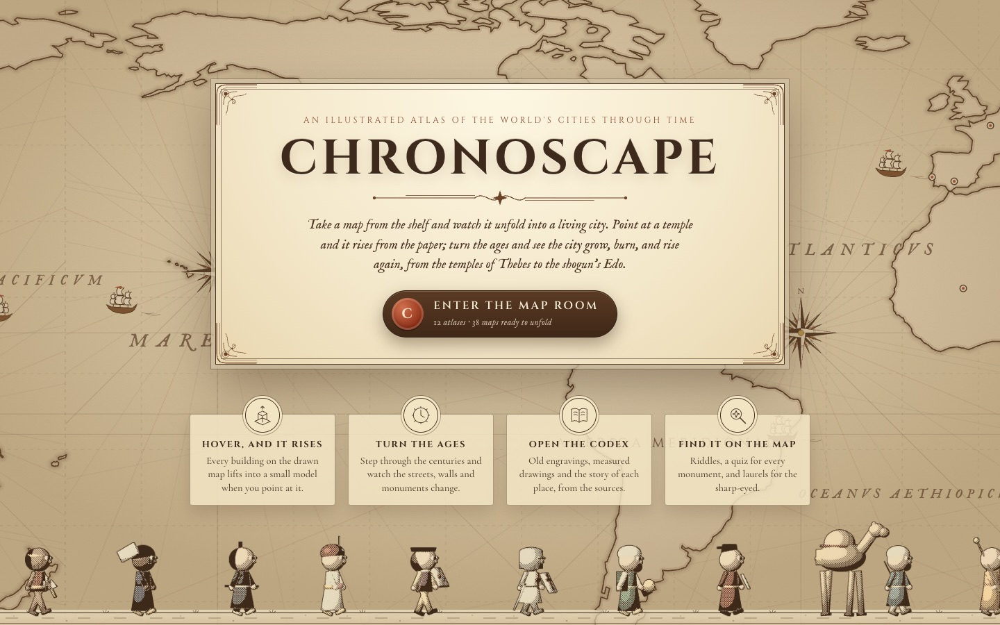
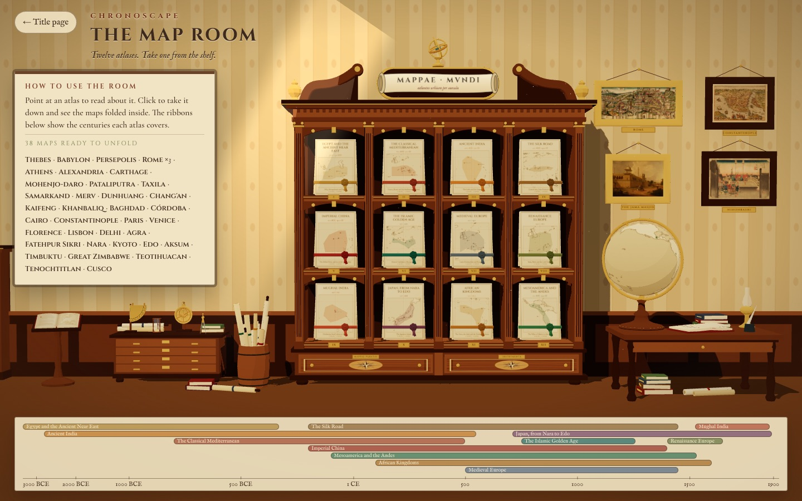
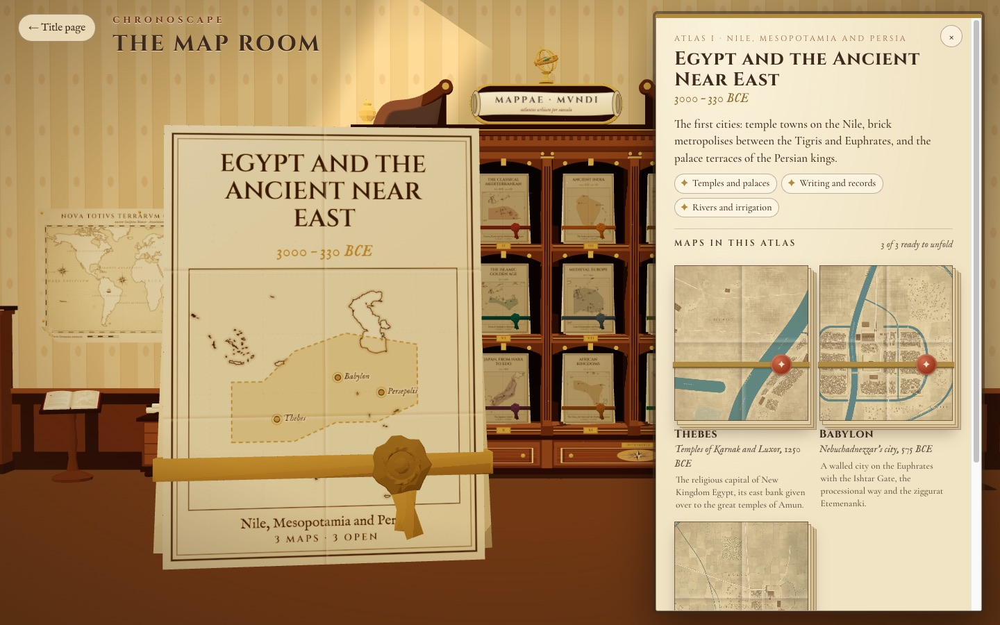
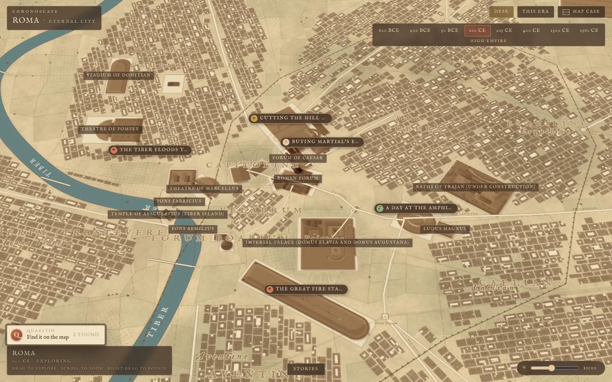
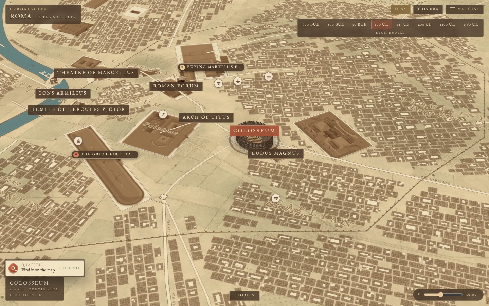
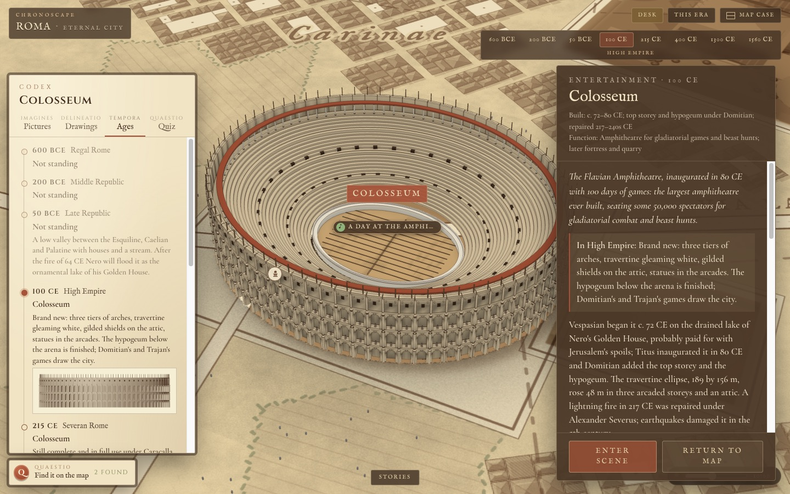
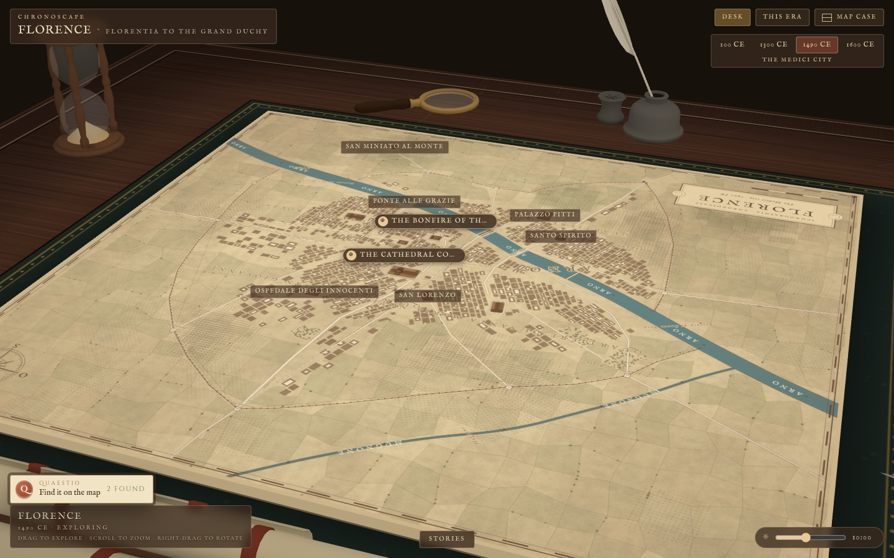
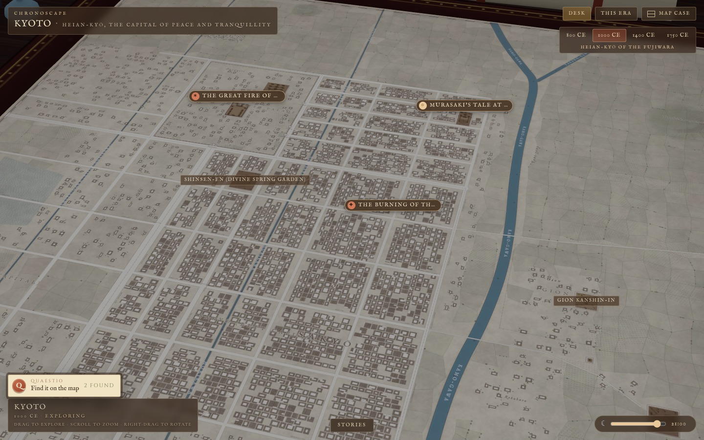
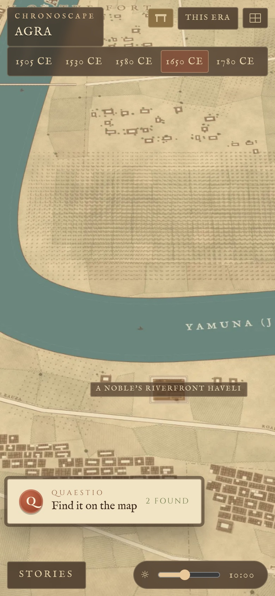

<p align="center">
  
</p>

<h1 align="center">Chronoscape</h1>

<p align="center">
  <b>An illustrated atlas of the world's cities through time.</b><br />
  Take a map from the shelf and watch it unfold into a living city. Point at a temple and it rises from the paper;<br />
  turn the ages and see the city grow, burn and rise again, from the temples of Thebes to the shogun's Edo.
</p>

<p align="center">
  <a href="https://chronoscape-threejs.ijlalahmad845.workers.dev"><b>Open Chronoscape →</b></a>
</p>

---

## What's inside

- **36 cities, 38 maps, 12 atlases**, from Thebes and Babylon to Kyoto, Tenochtitlan and Cusco, each drawn as a
  hand-inked parchment map with **its own eras**: Rome alone has eight, from the kingdom to the Renaissance.
- **Monuments rise from the map.** Every landmark is a small 3D model built in Blender, one per era where it changed:
  the Colosseum, the Round City of Baghdad, the Jama Masjid, the Templo Mayor.
- **Turn the ages.** Streets, walls, rivers and buildings change with the era; events (fires, floods, sieges,
  processions) are marked on the map, and the day dial moves the city from dawn to night.
- **The codex.** Each monument has its story, old engravings and photographs, measured drawings and a timeline of
  what stood there in every era, with sources.
- **Find it on the map.** A riddle hunt and a quiz for every city.
- **Works everywhere.** Mouse, trackpad and touch (a finger "lens" raises streets as it glides; two fingers rotate
  and tilt), from phones to wide screens.

## A look around

<table>
  <tr>
    <td width="50%"></td>
    <td width="50%"></td>
  </tr>
  <tr>
    <td><b>The map room.</b> Twelve atlases on the shelf; the ribbons below show the centuries each one covers.</td>
    <td><b>An atlas.</b> Its folded maps, ready to unfold into a city.</td>
  </tr>
  <tr>
    <td></td>
    <td></td>
  </tr>
  <tr>
    <td><b>Rome, 100 CE.</b> The High Empire: the fora, the Circus Maximus, the baths of Trajan under construction.</td>
    <td><b>Point, and it rises.</b> The Colosseum lifts off the paper as a miniature.</td>
  </tr>
  <tr>
    <td></td>
    <td></td>
  </tr>
  <tr>
    <td><b>The codex.</b> The Colosseum through every era, with its pictures, drawings and quiz.</td>
    <td><b>The desk.</b> Pull back and the map lies on a writing table, with things from its own part of the world.</td>
  </tr>
  <tr>
    <td></td>
    <td align="center"></td>
  </tr>
  <tr>
    <td><b>Heian-kyō at night.</b> Kyoto in 1000 CE, with the day dial turned to evening.</td>
    <td><b>On a phone.</b> Agra in 1650, with touch controls.</td>
  </tr>
</table>

## The atlases

| Atlas | Cities |
|---|---|
| Egypt and the Ancient Near East | Thebes · Babylon · Persepolis |
| The Classical Mediterranean | Rome · Athens · Alexandria · Carthage |
| Ancient India | Mohenjo-daro · Pataliputra · Taxila |
| The Silk Road | Samarkand · Merv · Dunhuang |
| Imperial China | Chang'an · Kaifeng · Khanbaliq |
| The Islamic Golden Age | Baghdad · Córdoba · Cairo |
| Medieval Europe | Rome · Constantinople · Paris · Venice |
| Renaissance Europe | Rome · Florence · Lisbon |
| Mughal India | Delhi · Agra · Fatehpur Sikri |
| Japan, from Nara to Edo | Nara · Kyoto · Edo |
| African Kingdoms | Aksum · Timbuktu · Great Zimbabwe |
| Mesoamerica and the Andes | Teotihuacan · Tenochtitlan · Cusco |

## How it's made

| Part | How |
|---|---|
| App | React 19, [react-three-fiber](https://github.com/pmndrs/react-three-fiber) and three.js, zustand, Vite; TypeScript throughout |
| Rendering | Unlit, shared shaders only: lighting is baked into the models' vertex colours in Blender, the day is one tint, nothing casts real-time shadows |
| Maps | Each era's parchment plate is drawn on a canvas from the city's data (rivers, walls, streets, blocks, fields), baked to WebP at build time; close-ups are redrawn sharp in a worker |
| 3D models | Generated by Python scripts in Blender (`tools/blender/`), baked and exported as Draco-compressed GLB |
| Content | Each city is a JSON pack built from Python sources (`tools/content/cities/<id>/`): geography in latitude/longitude and metres, landmarks, eras, events, stories, all checked against a zod schema |
| Hosting | Static files on Cloudflare Workers, built and deployed by GitHub Actions |

## Run it locally

```bash
pnpm install
pnpm dev          # http://localhost:5173
pnpm test         # vitest
pnpm validate     # content and asset checks
pnpm build        # validate, typecheck, bundle, bake the map plates into dist/plates
```

The plate bake drives a headless Chrome (set `CHROME=/path/to/chrome` if it isn't found). Plates are build output,
cached in `.plate-cache/`; only eras whose drawing changed are baked again, so a warm build takes about 15 seconds.

Every page has its own address and its own baked HTML head (title, description, keywords, share card, structured
data), written at build time by `scripts/build-pages.ts` from `src/meta.ts`, plus `sitemap.xml` and `robots.txt`:
`/` · `/atlases/` · `/atlases/japan/` · `/rome/` · `/rome/medieval-1300/` · `/rome/colosseum/`. A monument at another
era is `/rome/colosseum/?period=medieval-1300`, and `?spot=thermopolium`, `?event=great-fire-64` and `?hour=20`
work on top.

Controls: drag to pan, wheel to zoom, right-drag or shift-drag to orbit, arrows / + / − / Q / E on the keyboard,
Esc to step back. On touch: tap to raise, hold to glide, two fingers to zoom, rotate and tilt.

## Adding or changing a city

```bash
python3 tools/content/build_city.py <id>     # content/cities/<id>/city.json from tools/content/cities/<id>/*.py
python3 tools/content/build_rome.py          # Rome has its own builder
pnpm validate
```

The format is described in `tools/content/cities/FORMAT.md`, and every pack is fact-checked against
`tools/content/cities/REVIEW.md`. See [docs/MVP.md](docs/MVP.md) for the architecture and the full "adding a city" guide.

## Rebuilding the 3D models

Every landmark, prop and piece of furniture is generated by a bpy script and exported as GLB into `assets/models/`.

```bash
BAKE_CPU=1 Blender -b -P tools/blender/bake_all.py      # everything whose source changed (incremental)
BAKE_CPU=1 Blender -b -P tools/blender/bake_study.py    # just the desk and the things on it
pnpm assets:build                                       # or the whole pipeline
```

`FORCE=1` re-bakes everything. Set `BLENDER=/path/to/Blender` if the binary isn't at the default location.
Conventions: metres, origin at ground centre, top-level objects `p0_…`, `p1_…`, `p2_…` for the staged reveal.

## Deploying

Every build needs `SITE_URL`, the site's public address (canonical links, share images and the sitemap are written
with it). Locally, copy `.env.example` to `.env`; in GitHub Actions it is the repository variable `SITE_URL`.

The site is static and is served from Cloudflare Workers. Cloudflare's own build machines have no Chrome to bake the
plates with, so the build always happens elsewhere and only the upload goes to Cloudflare.

- **GitHub Actions** (`.github/workflows/build.yml`) builds every push and pull request. Pushes to `main` deploy to
  production; each pull request gets its own preview URL, posted on the PR. It needs the repository secrets
  `CLOUDFLARE_API_TOKEN` and `CLOUDFLARE_ACCOUNT_ID`, and the repository variable `SITE_URL`.
- **From your machine:** `pnpm deploy:cf` (production) or `pnpm deploy:cf --preview` (a preview URL named after the
  branch). Log in once with `pnpm dlx wrangler@4 login`.

## Layout

```
assets/            static files served as-is: models, media, fonts, social cards (og/)
content/           city packs (cities/<id>/city.json), the atlases, the registry
src/content/       schema (zod), validator, registry
src/engine/        renderer, camera, map, landmarks, the desk, state
src/ui/            the title page, the map room, HUD, codex, stories
scripts/           plate baker, content validation, deploy
tools/content/     the city sources and their builders
tools/blender/     the 3D pipeline: kits, per-city builders, bakers
tests/             vitest suites
```

## Credits

Historical images in the codex come from Wikimedia Commons and other public collections; each one is shown with its
artist, date, licence and a link to its source.

## Contributing

Corrections are the most welcome contribution: a wrong date, a misplaced monument, a dead source. See
[CONTRIBUTING.md](CONTRIBUTING.md) for setup, the content rules and how pull requests are previewed, and the
[Code of Conduct](CODE_OF_CONDUCT.md). Security problems: [SECURITY.md](SECURITY.md).

## Licence

- **Code** (the app, build scripts and tooling, including the Blender scripts): [MIT](LICENSE).
- **Content** (the city atlases and their texts, the maps, share cards and 3D models): [CC BY-NC 4.0](LICENSE-CONTENT),
  free to share and adapt with credit, not for commercial use.
- **Third-party material** keeps its own licence: historical pictures (each recorded with its artist and source,
  mostly public domain or Creative Commons via Wikimedia Commons), fonts (SIL Open Font License), land outlines
  (Natural Earth, public domain) and the Draco decoder (Apache 2.0).
